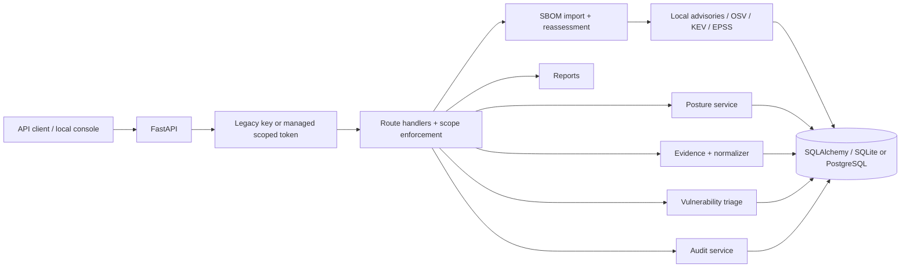

# DeviceTrust

**Product Security Intelligence & Evidence Management — an early-stage Python platform prototype for connected and embedded products.**

[](https://github.com/silvatechf/DeviceTrust/actions/workflows/ci.yml)
[](https://github.com/silvatechf/DeviceTrust/actions/workflows/codeql.yml)

DeviceTrust explores how teams can organise product and asset records, analyse supported software-component inventories, assess vulnerability information, document security decisions and retain traceable evidence across connected and embedded products.

The **initial customer hypothesis** is small and medium-sized **manufacturers of products with digital elements**, such as industrial gateways, sensors and embedded controllers. Product-security consultancies and specialist integrators are complementary users and potential channels. Food production and cold-chain infrastructure remain the synthetic demonstration context, not the limit of the product concept.

> **Current status:** early-stage Python/FastAPI prototype for local technical evaluation. DeviceTrust does not establish CRA compliance, perform conformity assessments, submit regulatory notifications, independently attest product contents, discover devices on networks, detect intrusions or prevent attacks.

## Product direction

The intended workflow is to connect:

1. Product, asset and version context.
2. Software-component inventories and their provenance.
3. Vulnerability intelligence and affected-version assessment.
4. Reviewed security decisions, including future VEX support.
5. Evidence, audit history and exportable assessment records.

This direction is relevant to product-security workflows under the EU Cyber Resilience Act (CRA), but DeviceTrust currently supports only a small subset of the underlying engineering activities. CRA obligations extend beyond SBOMs and vulnerability triage. Legal applicability and manufacturer responsibilities must be assessed for each product and organisation.

See [Market Positioning](docs/market-positioning.md) for target users, buyer hypotheses, regulatory boundaries, market validation and the claims policy.

## The current prototype

The application is built with Python, FastAPI, Pydantic and SQLAlchemy. It is a modular monolith intended for local evaluation and technical learning.

Implemented prototype workflows:

1. Store device inventory and declared security attributes.
2. Assess declared profiles and keep missing information as `unverified`.
3. Accept bounded evidence observations while preserving source and timestamps.
4. Parse a supported subset of CycloneDX JSON and match components against synthetic demo advisories; optionally query OSV.
5. Record vulnerability-triage decisions with a mandatory justification.
6. Generate JSON/Markdown reports and verify a SHA-256-linked audit history.
7. Persist accepted product-release SBOM imports, component occurrences and product-scoped findings through the authenticated product SBOM API.
8. Compare accepted SBOM imports for a product release using version-independent PURL identity.
9. Reassess stored imports through append-only, idempotent assessment runs with component-scoped findings.
10. Optionally enrich CVE-backed assessment findings with CISA KEV and FIRST EPSS signals (merged in main via PR #55).
11. Use a same-origin local operator console.
12. Authenticate API clients through legacy shared-key mode or individually revocable, expiring, scoped managed tokens (merged in main via PR #55).
13. Preserve source-aware applicability signals for versioned findings (merged in main via PR #55).
14. Preserve original CycloneDX BOM and component references for future VEX linkage (merged in main via PR #55).
15. Record attributable, append-only vulnerability review decisions against immutable assessment findings (integrated through PR #56).
16. Register operator-controlled Ed25519 public keys and verify detached signatures bound to exact immutable decision revisions (implemented in the trust-assurance work; second-person approval and VEX export remain future work).

Evidence observations are currently stored separately from posture inputs. Ingestion does not prove a claim, identify a product or device, or change its posture result. The legacy device-scoped SBOM workflow remains available. The product-scoped SBOM persistence flow is merged into `main`. The merged implementation is covered by successful post-merge CI and CodeQL runs for the current main commit. PostgreSQL integration and API-flow tests are included in the automated test suite, while a clean local Compose walkthrough remains part of the release gate.

### Product-scoped SBOM API

The persistent SBOM work introduces these authenticated endpoints:

- `POST /products` — create a declared product identity.
- `POST /products/{product_id}/releases` — create a product release.
- `POST /product-releases/{release_id}/sbom` — import a bounded CycloneDX JSON 1.5 document.
- `GET /product-releases/{release_id}/sbom` — list accepted imports.
- `GET /product-releases/{release_id}/sbom/diff?from_import_id=1&to_import_id=2` — compare two accepted imports for the same release.
- `GET /sbom/imports/{import_id}/components` — list immutable component occurrences.
- `GET /sbom/components/{component_id}/findings` — list findings tied to a component occurrence.
- `POST /sbom/imports/{import_id}/assessments` — request a new assessment with an `Idempotency-Key`.
- `GET /sbom/imports/{import_id}/assessments` — list historical assessment runs.
- `GET /sbom/imports/{import_id}/assessments/{assessment_id}/findings` — list findings for one run.
- `POST /sbom/assessment-findings/{finding_id}/decisions` — append an attributable human review revision (managed operator with `assessment:review` and an `Idempotency-Key`).
- `GET /sbom/assessment-findings/{finding_id}/decisions` — retrieve the complete decision history.

The import digest is calculated from the exact request bytes. A repeated digest for the same release and format returns the existing import. Only fully validated imports are persisted. The API does not store raw SBOM documents or infer a relationship between a product and a device.

The comparison reports additions, removals and matched-component changes. Matching excludes only the PURL version; qualifiers and subpath remain identity boundaries. Duplicate identities are marked ambiguous, and components without usable PURLs remain unidentified rather than being matched by name or ordinal. The comparison is read-only and does not re-evaluate vulnerability findings. PURL identity is a conservative heuristic, not proof of artifact or supplier equivalence.

Versioned reassessment history was merged through [PR #45](https://github.com/silvatechf/DeviceTrust/pull/45). It appends assessment runs and component-scoped findings without mutating the imported SBOM or legacy triage records. Requests require an idempotency key; a new key deliberately creates a new historical run.

Optional CISA KEV and FIRST EPSS enrichment was integrated into `main` through [PR #55](https://github.com/silvatechf/DeviceTrust/pull/55). Provider observations are stored in the assessment snapshot with explicit coverage states and source/date provenance. These CVE-level signals do not establish product impact or produce VEX/CRA decisions. The same aggregate adds separate source-aware applicability evidence for versioned findings. The current reviewed-decision PR adds a separate append-only operator decision history, requiring rationale and evidence for not_affected; it still does not generate VEX.

The product SBOM persistence API was merged through [PR #22](https://github.com/silvatechf/DeviceTrust/pull/22). Comparison and versioned reassessment are implemented in the current prototype; see the PR history and test matrix for exact validation evidence. None of these workflows makes DeviceTrust a production-ready service.

## What is not implemented

- Product-to-device relationship inference.
- SPDX ingestion or CycloneDX VEX generation.
- CycloneDX VEX generation, second-person approval, evidence-artifact verification, external audit anchoring and vendor-specific backport analysis. Ed25519 detached decision signatures and offline public-key lifecycle are implemented in PR #57 (pending review); signatures remain optional and do not establish legal identity or manufacturer authority.
- Human login, MFA, SSO, tenant isolation and web-based credential administration. Managed API principals and route scopes are implemented in the identity implementation branch; offline CLI administration is required.
- Automated CRA reporting, ENISA Single Reporting Platform integration or conformity assessment.
- Active LAN discovery, packet capture, device agents or independent firmware/hardware attestation.
- Immutable/WORM audit storage, external audit checkpoints or independent audit anchoring.
- Production operations, real-time intrusion detection, incident-response automation or attack prevention.

See [Prototype limitations](docs/prototype-limitations.md), [Threat model](docs/threat-model.md) and [Release readiness](docs/release-readiness.md).

## Architecture at a glance

DeviceTrust is a **modular monolith**, not a set of microservices. FastAPI handles HTTP requests and authentication; route handlers coordinate domain logic; SQLAlchemy persists devices, evidence, vulnerabilities and audit events.



The diagram shows the current application structure, not a deployment topology. See [Architecture](docs/architecture.md) for request flow and trust boundaries.

## Run locally

### 1. Create a virtual environment

**Windows PowerShell**
```powershell
python -m venv .venv
.venv\Scripts\Activate.ps1
pip install -r requirements-dev.txt
$env:DEVICETRUST_API_KEY = "replace-with-a-random-local-secret"
```

**macOS / Linux**
```bash
python -m venv .venv
source .venv/bin/activate
pip install -r requirements-dev.txt
export DEVICETRUST_API_KEY="replace-with-a-random-local-secret"
```

Keep this key local. Do not commit it or reuse a production credential.

### 2. Apply migrations and start the API

```bash
alembic upgrade head
uvicorn app.main:app --reload
```

Schema changes are managed through Alembic. The application does not create or modify database tables at startup. Run `alembic upgrade head` after installing dependencies and whenever a new migration is introduced.

- Operator console: http://127.0.0.1:8000/
- Interactive API documentation: http://127.0.0.1:8000/docs

The console keeps the supplied API credential in page memory only. The default local authentication mode is legacy; managed mode accepts individually revocable scoped tokens. Use the console only with a trusted local instance and do not expose this prototype to the public internet.

#### Optional managed API credentials

After applying migrations, generate a 32-byte random verifier pepper (`python -c "import secrets; print(secrets.token_hex(32))"`), store it as `DEVICETRUST_CREDENTIAL_PEPPER` for both the API and CLI, create an operator credential through the offline CLI, and set `DEVICETRUST_AUTH_MODE=managed` in the API process:

```bash
python -m app.identity_cli create-principal --name "Local operator" --kind operator --scope inventory:read --scope inventory:write --scope evidence:read --scope evidence:write --scope sbom:read --scope sbom:write --scope assessment:read --scope assessment:write --scope audit:read
```

The token is displayed once and is accepted through the existing `X-API-Key` header. The pepper must be kept outside the database and shared by all API instances. Additional credentials can be issued for an existing principal before revoking an older token. Managed mode ignores `DEVICETRUST_API_KEY`; it never falls back to the shared key. See [Identity and Access Governance](docs/identity-access-governance.md) for rotation, revocation, disablement and the complete scope list.

### 3. Load synthetic demo data (optional)

Use a dedicated disposable SQLite file for the demonstration. Do not point the demo seeder at a database containing data you need to preserve.

**Windows PowerShell** (run these commands in the same terminal session):
```powershell
$env:DATABASE_URL = "sqlite:///devicetrust-demo.db"
python -m app.seed
uvicorn app.main:app --reload
```

**macOS / Linux**:
```bash
export DATABASE_URL="sqlite:///devicetrust-demo.db"
python -m app.seed
uvicorn app.main:app --reload
```

The seeder creates three synthetic devices and imports the sample CycloneDX document for `EDGE-GW-003`. It does not reset an existing database. See the [Demo runbook](docs/demo-runbook.md).

## Optional PostgreSQL setup

Copy `.env.example` to `.env`, replace both placeholders with independent random secrets, then run:

```bash
docker compose up --build
```

The container applies Alembic migrations before starting the API. The API port is bound to localhost. Keep `.env` private and never commit it. PostgreSQL integration and restart persistence are exercised in CI; backup/restore and operational recovery still require manual verification.

## Run quality checks

```bash
pre-commit validate-config
pre-commit install-hooks
ruff check .
bandit -q -r app
pip-audit -r requirements.txt
pip-audit -r requirements-dev.txt
node --check web/app.js
pytest -q
```

GitHub Actions validates the pre-commit configuration, provisions hook environments, audits runtime and development dependencies separately, scans reachable Git history with checksum-verified Gitleaks, and runs PostgreSQL and disposable Compose checks. CodeQL is configured separately. Check the exact commit's workflow results before claiming they passed. Tests and static analysis provide useful evidence, not proof that the application is secure or production-ready. The [test matrix](docs/test-matrix.md) maps controls to test locations and records remaining gaps.

## Security principles

- Missing information stays unknown; it is not treated as safe.
- Submitted product, device and evidence claims are not independent attestation.
- Weak identifiers such as MAC, IP and hostname are not identity proof.
- Vulnerability triage requires a written justification.
- KEV presence and EPSS scores are intelligence signals, not automatic CRA reporting triggers.
- VEX statements require product-version context, evidence and reviewed justification.
- Application writers sharing one database are serialized transactionally through the singleton audit-chain state row: PostgreSQL holds the row lock through the transaction, while SQLite uses `BEGIN IMMEDIATE`.
- Audit hash chaining provides tamper evidence, not immutable storage. A privileged database administrator or an external writer can still tamper with the chain; there is no external checkpoint or independent audit anchoring.
- External intelligence failures or missing results do not mean that a component is vulnerability-free.
- DeviceTrust is an assessment and evidence-management prototype, not an inline IDS/IPS or product conformity assessor.

Read [SECURITY.md](SECURITY.md) before reporting a vulnerability. Contributions should follow [CONTRIBUTING.md](CONTRIBUTING.md).

## Technical documentation

| Document | What it helps explain |
|---|---|
| [Market positioning](docs/market-positioning.md) | Target market, CRA context, buyer hypotheses and claims policy |
| [Architecture](docs/architecture.md) | Request flow, modules, data flow and trust boundaries |
| [Engineering decisions](docs/engineering-decisions.md) | Why the current design was chosen and its trade-offs |
| [Security controls](docs/security-controls.md) | Implemented controls, tests and limitations |
| [Threat model](docs/threat-model.md) | Assets, trust boundaries, abuse cases and residual risks |
| [Evidence ingestion](docs/evidence-ingestion.md) | Evidence API behavior and validation boundaries |
| [Evidence normalization](docs/evidence-normalization.md) | Canonical attributes, normalization and future association |
| [Operator console](docs/operator-console.md) | Browser workflow and credential boundary |
| [Demo runbook](docs/demo-runbook.md) | Repeatable local walkthrough with synthetic data |
| [Prototype limitations](docs/prototype-limitations.md) | What must not be claimed |
| [Test matrix](docs/test-matrix.md) | Control-to-test mapping and manual verification gaps |
| [Release readiness](docs/release-readiness.md) | Evidence required before a release |
| [Roadmap](docs/roadmap.md) | Implemented work and next steps |
| [Interview guide](docs/interview-guide.md) | A clear way to explain the project and defend decisions |
| [Changelog](CHANGELOG.md) | Development history |

## References

- Regulation (EU) 2024/2847 — Cyber Resilience Act.
- European Commission — Cyber Resilience Act implementation and reporting obligations.
- ENISA — CRA Single Reporting Platform.
- CycloneDX — Software Bill of Materials (SBOM) and Vulnerability Exploitability eXchange (VEX).
- SPDX — Software component and supply-chain data exchange.
- CISA Known Exploited Vulnerabilities (KEV) Catalog.
- FIRST — Exploit Prediction Scoring System (EPSS).
- OSV — Open Source Vulnerabilities database and API.

## License

No license has been selected. Until one is added, all rights are reserved. See the release-readiness checklist before publishing a versioned release.
