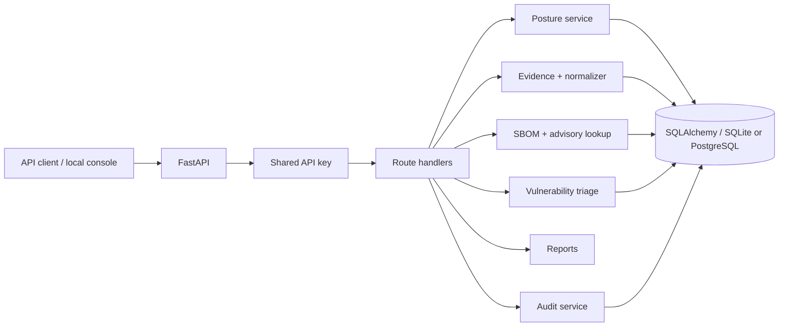

# DeviceTrust

**A Python/FastAPI prototype for IoT security evidence and vulnerability triage**

[](https://github.com/silvatechf/DeviceTrust/actions/workflows/ci.yml)
[](https://github.com/silvatechf/DeviceTrust/actions/workflows/codeql.yml)

DeviceTrust explores a practical question: **how can a team keep device inventory, security posture, software-component findings and investigation decisions in one traceable workflow?**

It is an engineering prototype built with Python, FastAPI, Pydantic and SQLAlchemy. It is intended for local evaluation and technical learning, not production deployment.

> **Current status:** early-stage prototype. DeviceTrust does not actively discover devices, independently verify device claims, prevent attacks or certify compliance with the EU Cyber Resilience Act (CRA).

## The problem and the approach

IoT security information arrives from different places: inventories, vendor declarations, router exports and SBOM files. Inputs can be incomplete, stale or wrong. Treating missing information as proof of safety creates false confidence.

DeviceTrust brings selected inputs into one API and keeps their limits visible:

1. Store device inventory and declared security attributes.
2. Assess the declared profile and keep missing information as `unverified`.
3. Accept bounded evidence observations while preserving source and timestamps.
4. Parse a supported subset of CycloneDX JSON and match components against synthetic demo advisories; optionally query OSV.
5. Let an operator record a vulnerability triage status with a justification.
6. Generate JSON/Markdown reports and verify a SHA-256-linked audit history.

Evidence observations are currently stored separately from posture inputs. Ingestion does not prove a claim, identify a device or change its posture result.

## What is implemented

- FastAPI HTTP API with shared API-key authentication.
- Pydantic request validation and bounded input fields.
- SQLAlchemy persistence; SQLite by default, PostgreSQL configurable through `DATABASE_URL`.
- Device inventory and declared-profile posture assessment.
- Explicit `unverified` results when required posture information is missing.
- Bounded evidence ingestion, unassigned observations and read-only normalization for selected attributes.
- Bounded CycloneDX JSON parsing and PURL-based component matching.
- Synthetic local demo advisories and optional best-effort OSV lookup.
- Vulnerability triage with mandatory justification.
- JSON and Markdown device reports.
- SHA-256 hash-linked audit entries and integrity verification.
- Same-origin local operator console served by FastAPI.

## What is not implemented

- Active LAN discovery, packet capture or device agents.
- Independent device identity, firmware-signature or hardware attestation.
- Automatic association of unassigned observations with devices.
- Evidence-driven posture calculations or source-conflict resolution.
- Full CycloneDX schema/dependency-graph validation or complete CVE coverage.
- Individual operator accounts, RBAC, tenant isolation or production browser sessions.
- Immutable/WORM audit storage, external audit checkpoints or multi-writer serialization.
- Production operations, incident response automation or CRA conformity assessment.

See [Prototype limitations](docs/prototype-limitations.md), [Threat model](docs/threat-model.md) and [Release readiness](docs/release-readiness.md).

## Architecture at a glance

DeviceTrust is a **modular monolith**, not a set of microservices. FastAPI handles HTTP requests and authentication; route handlers coordinate domain logic; SQLAlchemy persists devices, evidence, vulnerabilities and audit events.



The diagram shows the current application structure, not a deployment topology. See [Architecture](docs/architecture.md) for request flow and trust boundaries.

## Run locally

### 1. Create a virtual environment

**Windows PowerShell**
```powershell
python -m venv .venv
.venv\Scripts\Activate.ps1
pip install -r requirements-dev.txt
$env:DEVICETRUST_API_KEY = "replace-with-a-random-local-secret"
```

**macOS / Linux**
```bash
python -m venv .venv
source .venv/bin/activate
pip install -r requirements-dev.txt
export DEVICETRUST_API_KEY="replace-with-a-random-local-secret"
```

Keep this key local. Do not commit it or reuse a production credential.

### 2. Start the API

```bash
uvicorn app.main:app --reload
```

- Operator console: http://127.0.0.1:8000/
- Interactive API documentation: http://127.0.0.1:8000/docs

The console receives the shared API key in browser memory. Use it only with a trusted local instance. Do not expose the service or key to the public internet.

### 3. Load synthetic demo data (optional)

Stop the server first if you want to prepare a clean disposable database:

```bash
python -m app.seed
```

The seeder creates three synthetic devices and imports the sample CycloneDX document for `CAM-002`. It does not reset an existing database. Use a fresh disposable database for a repeatable walkthrough. See the [Demo runbook](docs/demo-runbook.md).

## Optional PostgreSQL setup

Copy `.env.example` to `.env`, replace both placeholders with independent random secrets, then run:

```bash
docker compose up --build
```

The API port is bound to localhost. Keep `.env` private and never commit it. PostgreSQL support is configurable, but integration, restart and backup/restore behavior still require manual verification.

## Run quality checks

```bash
ruff check .
bandit -q -r app
pip-audit -r requirements.txt
node --check web/app.js
pytest -q
```

GitHub Actions runs the configured checks on pushes and pull requests; CodeQL is configured separately. Check the exact commit's workflow results before claiming they passed. Tests and static analysis provide useful evidence, not proof that the application is secure or production-ready. The [test matrix](docs/test-matrix.md) maps controls to test locations and records remaining gaps.

## Security principles

- Missing information stays unknown; it is not treated as safe.
- Submitted device and evidence claims are not independent attestation.
- Weak identifiers such as MAC, IP and hostname are not identity proof.
- Vulnerability triage requires a written justification.
- Audit hash chaining provides tamper evidence, not immutable storage.
- External intelligence failures or missing results do not mean that a component is vulnerability-free.

Read [SECURITY.md](SECURITY.md) before reporting a vulnerability. Contributions should follow [CONTRIBUTING.md](CONTRIBUTING.md).

## Technical documentation

| Document | What it helps explain |
|---|---|
| [Architecture](docs/architecture.md) | Request flow, modules, data flow and trust boundaries |
| [Engineering decisions](docs/engineering-decisions.md) | Why the current design was chosen and its trade-offs |
| [Security controls](docs/security-controls.md) | Implemented controls, tests and limitations |
| [Threat model](docs/threat-model.md) | Assets, trust boundaries, abuse cases and residual risks |
| [Evidence ingestion](docs/evidence-ingestion.md) | Evidence API behavior and validation boundaries |
| [Evidence normalization](docs/evidence-normalization.md) | Canonical attributes, normalization and future association |
| [Operator console](docs/operator-console.md) | Browser workflow and credential boundary |
| [Demo runbook](docs/demo-runbook.md) | Repeatable local walkthrough with synthetic data |
| [Prototype limitations](docs/prototype-limitations.md) | What must not be claimed |
| [Test matrix](docs/test-matrix.md) | Control-to-test mapping and manual verification gaps |
| [Release readiness](docs/release-readiness.md) | Evidence required before a release |
| [Roadmap](docs/roadmap.md) | Implemented work and next steps |
| [Interview guide](docs/interview-guide.md) | A clear way to explain the project and defend decisions |
| [Changelog](CHANGELOG.md) | Development history |

## References

- NISTIR 8259 — Foundational Cybersecurity Activities for IoT Device Manufacturers.
- CycloneDX — Software Bill of Materials (SBOM) standard.
- OSV — Open Source Vulnerabilities database and API.
- CISA Known Exploited Vulnerabilities (KEV) Catalog.
- Regulation (EU) 2024/2847 — Cyber Resilience Act.

## License

No license has been selected. Until a license is added, all rights are reserved; public visibility does not grant permission to reuse, modify or redistribute this project.
