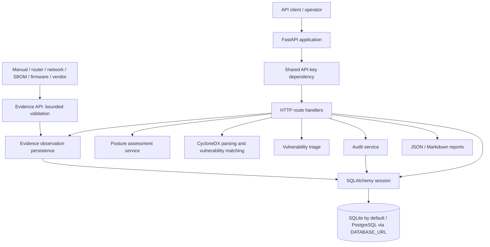
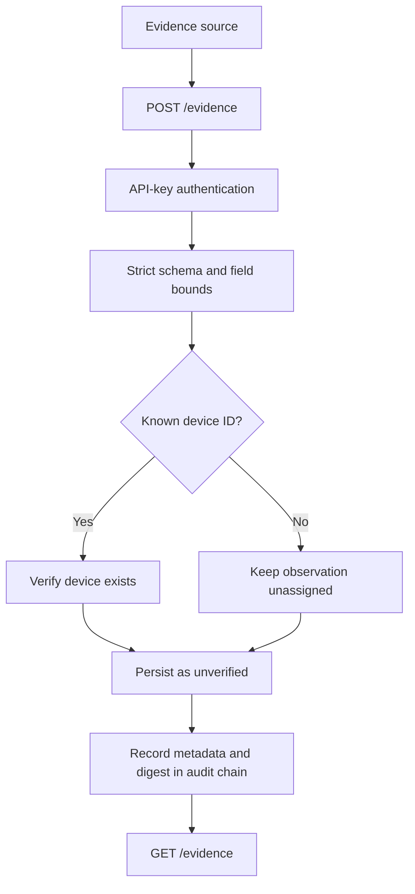

# Architecture and Visual Technical Reference

**Documentation status:** diagrams describe the current repository implementation at the time of this change. They are editable Mermaid source, not runtime screenshots or operational evidence.

## 1. System architecture

DeviceTrust is a modular monolith. HTTP requests enter FastAPI, authentication dependencies and request validation are resolved at the API boundary, route handlers coordinate domain services, and SQLAlchemy persists device, evidence, vulnerability and audit records. Typed endpoints use the Pydantic models in `app/schemas.py`; the SBOM endpoint accepts a raw `Request` and applies bounded JSON and CycloneDX validation explicitly.

### Component responsibilities

| Component | Current responsibility | Implementation |
|---|---|---|
| API boundary | Authentication, request handling and response serialization | `app/main.py` |
| Input contracts | Strict Pydantic schemas and bounded fields | `app/schemas.py` |
| Device persistence | Device inventory and declared security profile | `app/db.py` |
| Evidence persistence | Source-attributed observations, timestamps, confidence and verification state | `app/db.py`, `app/main.py` |
| Evidence normalization | Versioned, read-only projection for selected attributes; preserves raw observations | `app/evidence_normalization.py`, `app/main.py` |
| Posture service | Evidence-based control findings and risk summary | `app/posture.py` |
| SBOM service | Bounded CycloneDX component parsing, PURL validation and optional OSV lookup | `app/sbom.py` |
| Triage | Status and mandatory justification for vulnerability decisions | `app/main.py`, `app/schemas.py` |
| Audit | SHA-256 hash-linked event records and verification | `app/audit.py` |
| Reporting | Per-device posture, vulnerability and evidence-trail report | `app/main.py` |

## 2. Evidence ingestion

Observations retain source type, attribute, value, source observation time, server recording time, confidence, optional artifact reference and optional SHA-256 digest. The server assigns `unverified`; clients cannot self-assert verification. Unassigned observations are not automatically merged into device records. The evidence API does not fetch supplied references or independently authenticate source claims.

## 3. Trust boundaries and attack surfaces

- The API uses one shared `DEVICETRUST_API_KEY`; it is not user identity, role-based authorization or tenant isolation.
- Missing server-side API-key configuration fails closed with HTTP 503; a wrong key receives HTTP 401.
- Evidence input is untrusted and bounded by strict Pydantic field constraints. References are opaque strings and are never dereferenced.
- Device security and management-interface attributes remain declared evidence. DeviceTrust does not independently attest that submitted claims are true.
- SBOM input is capped at 2 MiB and validates a bounded CycloneDX subset.
- OSV is optional and best-effort; a missing result is not proof that a component is safe.
- The audit hash chain is tamper-evident, not immutable; there is no external checkpoint.

## 4. Device security posture assessment

The posture service continues to assess the existing declared device security profile. Evidence observations are stored separately in this increment and do not yet change posture results. Missing data remains unverified; ingestion alone does not imply a control is verified.

## 5. SBOM ingestion and vulnerability workflow

The existing bounded CycloneDX workflow remains unchanged: authenticate, cap request body, validate JSON and component bounds, normalize PURLs, correlate local demo advisories and optional OSV results, persist findings and audit the import. The local demo feed is synthetic, not vulnerability intelligence.

## 6. Audit event and hash-chain flow

State-changing operations append an event with timestamp, actor, action, entity and payload. Evidence audit events include source type, attribute, confidence and artifact digest, but deliberately omit the raw observation value. The chain detects modification of retained entries but cannot detect deletion of its final suffix without an independently retained checkpoint.

## 7. CI / DevSecOps pipeline

GitHub Actions runs Ruff, Bandit, pip-audit and pytest. Automated checks do not prove absence of vulnerabilities or replace human review.

## 8. Implemented versus planned

| Capability | Status |
|---|---|
| Device inventory and declared security profile | Implemented prototype |
| Evidence observation ingestion and listing | Implemented prototype |
| Unassigned observations for unidentified assets | Implemented prototype |
| Read-only normalized evidence projection | Implemented prototype; selected attributes only |
| Canonical evidence normalization | Initial pure normalizers implemented for selected attributes; limited prototype coverage |
| Evidence-to-device association and conflict resolution | Planned |
| Evidence-driven posture assessment | Planned |
| CycloneDX bounded-subset ingestion | Implemented prototype |
| Local PURL-scoped advisory matching | Synthetic demo implementation |
| Optional version-scoped OSV lookup | Implemented, best-effort |
| Vulnerability triage with justification | Implemented prototype |
| JSON and Markdown reports | Implemented prototype |
| Hash-chain audit verification | Implemented with documented limitations |
| CISA KEV enrichment, event monitoring, lifecycle intelligence | Planned |
| RBAC, tenant isolation, external audit checkpoints | Not implemented |

## 9. Source-of-truth map

- API routes and request orchestration: `app/main.py`
- Input validation: `app/schemas.py`
- Persistence models and database configuration: `app/db.py`
- Posture rules: `app/posture.py`
- SBOM parsing and vulnerability matching: `app/sbom.py`
- Audit event hashing and verification: `app/audit.py`
- Evidence normalization and association policy: [Evidence normalization design](evidence-normalization.md)
- Security control mapping: [Security controls and evidence](security-controls.md)
- Abuse cases and residual risks: [Threat model](threat-model.md)
- Known prototype boundaries: [Prototype limitations](prototype-limitations.md)
