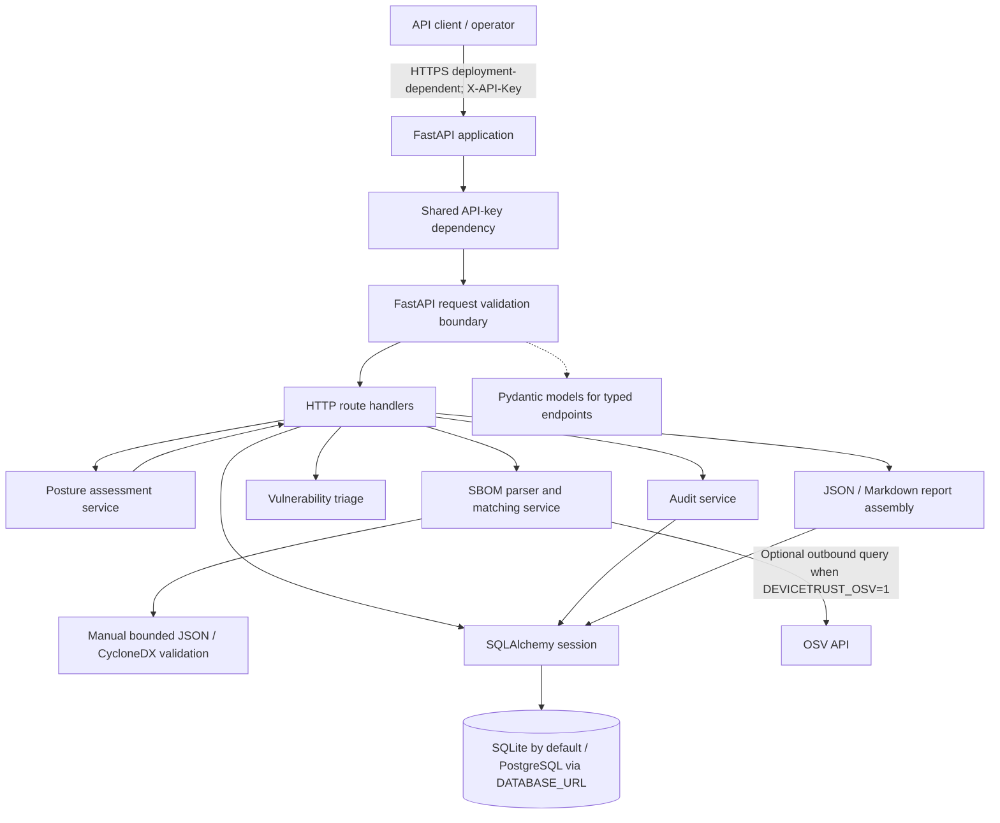
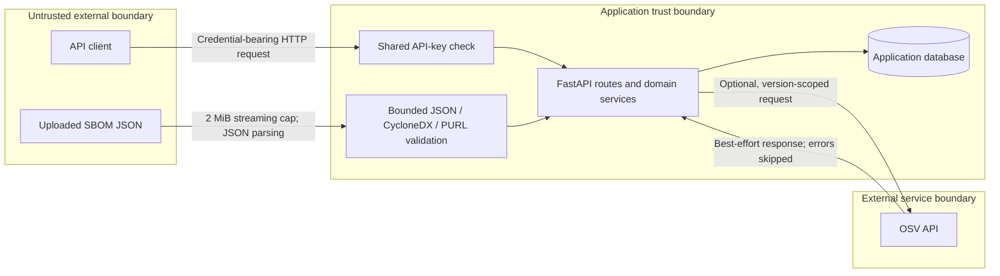
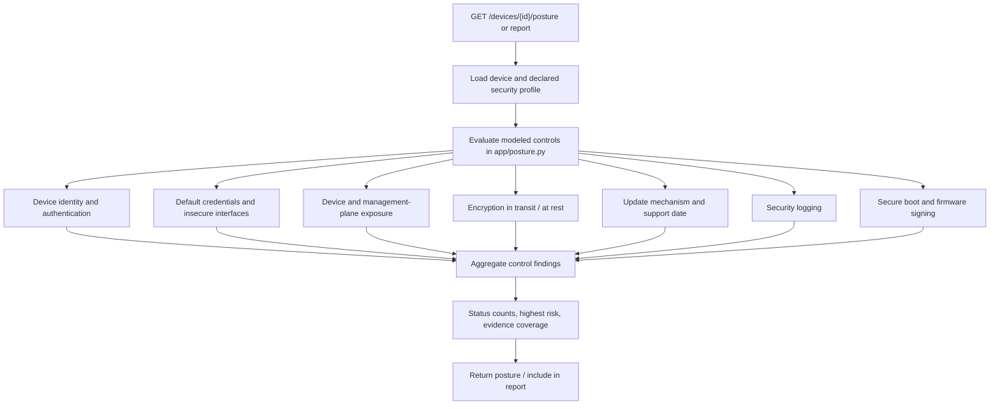
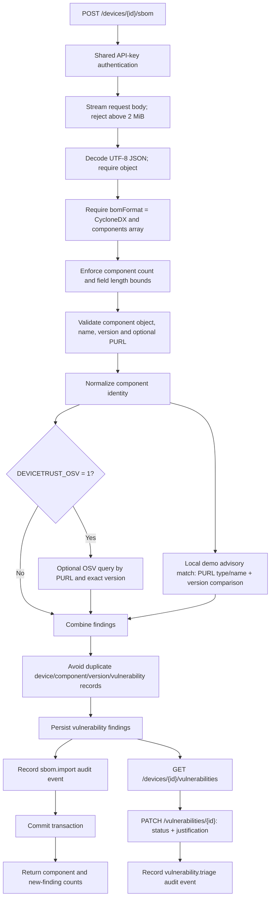
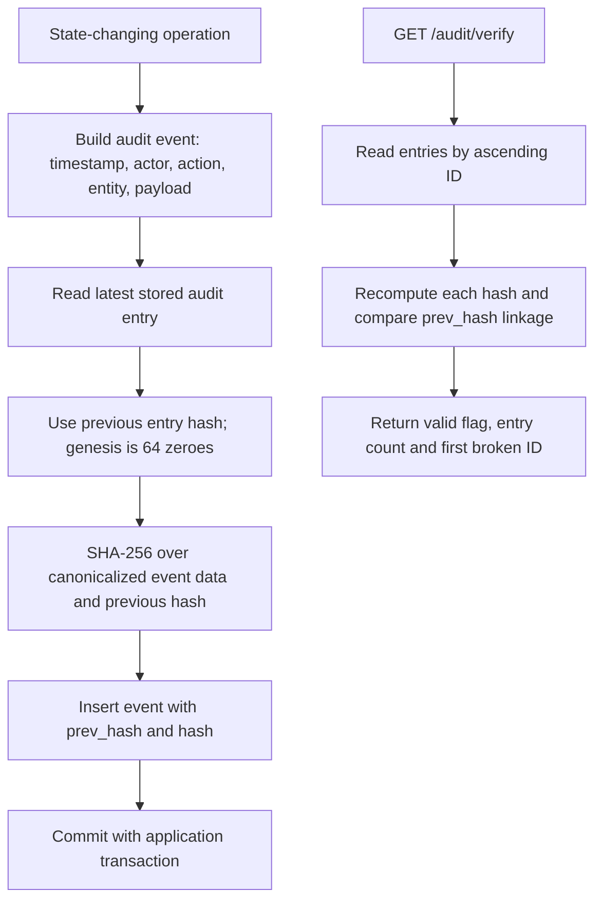
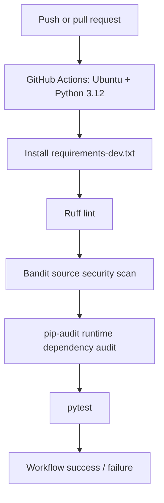

# Architecture and Visual Technical Reference

**Documentation status:** diagrams describe the current repository implementation at the time of this change. They are editable Mermaid source, not runtime screenshots or operational evidence.

## 1. System architecture

DeviceTrust is a modular monolith. HTTP requests enter FastAPI, authentication dependencies and request validation are resolved at the API boundary, route handlers coordinate domain services, and SQLAlchemy persists device, vulnerability and audit records. Typed endpoints use the Pydantic models in `app/schemas.py`; the SBOM endpoint accepts a raw `Request` and applies bounded JSON and CycloneDX validation explicitly.

### Component responsibilities

| Component | Current responsibility | Implementation |
|---|---|---|
| API boundary | Authentication, request handling and response serialization | `app/main.py` |
| Input contracts | Strict Pydantic schemas and bounded fields | `app/schemas.py` |
| Device persistence | Device inventory and declared security profile | `app/db.py` |
| Posture service | Evidence-based control findings and risk summary | `app/posture.py` |
| SBOM service | Bounded CycloneDX component parsing, PURL validation and optional OSV lookup | `app/sbom.py` |
| Triage | Status and mandatory justification for vulnerability decisions | `app/main.py`, `app/schemas.py` |
| Audit | SHA-256 hash-linked event records and verification | `app/audit.py` |
| Reporting | Per-device posture, vulnerability and evidence-trail report | `app/main.py` |

## 2. Trust boundaries and attack surfaces

**Security interpretation**

- The API uses one shared `DEVICETRUST_API_KEY`; it is not user identity, role-based authorization or tenant isolation.
- Missing server-side API-key configuration fails closed with HTTP 503; a wrong key receives HTTP 401.
- SBOM input is untrusted. The endpoint reads a raw request body capped at 2 MiB, then manually validates JSON and a bounded subset of CycloneDX components; it does not use a dedicated Pydantic SBOM request model.
- Device security and management-interface attributes are declared evidence. DeviceTrust does not independently probe device reachability or attest that submitted claims are true.
- OSV is an optional external dependency. Network and response errors are skipped; a missing result is not proof that a component is safe.
- The database is inside the application trust boundary. The current audit hash chain does not provide immutable/WORM storage or an external checkpoint.

## 3. Device security posture assessment

Each modeled control returns a status such as `compliant`, `partial`, `non_compliant` or `unverified`. Missing evidence is not treated as compliance. The assessment uses declared metadata; it is not a device scan, safety interlock or CRA conformity assessment.

## 4. SBOM ingestion and vulnerability workflow

**Important boundaries**

- The local `DT-DEMO-*` advisory file is synthetic demonstration data, not a vulnerability feed.
- Local matching requires PURL package type/name identity and a version comparison; components without a PURL are not matched against the local demo records.
- CycloneDX validation covers a bounded subset, not the complete specification or dependency graph.
- OSV lookup is opt-in and best-effort. It does not persist full affected-range provenance.
- Triage supports `open`, `in_progress`, `fixed`, `accepted_risk` and `not_affected`; the request requires a justification of at least 10 characters.

## 5. Audit event and hash-chain flow

The chain detects mutation or gaps that break a retained link. It cannot detect deletion of the final entry or final suffix without an independently retained checkpoint. A privileged database actor may rewrite records and recompute the chain. Concurrent writers are not serialized by an external chain-head mechanism.

## 6. CI / DevSecOps pipeline

The workflow runs on pushes, pull requests and manual dispatch. The checks are automated validation gates; they do not prove absence of vulnerabilities or replace human review.

## 7. Implemented versus planned

| Capability | Status represented by this architecture |
|---|---|
| Device inventory and declared security profile | Implemented prototype |
| Evidence-based posture assessment | Implemented prototype |
| CycloneDX bounded-subset ingestion | Implemented prototype |
| Local PURL-scoped advisory matching | Synthetic demo implementation |
| Optional version-scoped OSV lookup | Implemented, best-effort |
| Vulnerability triage with justification | Implemented prototype |
| JSON and Markdown reports | Implemented prototype |
| Hash-chain audit verification | Implemented with documented limitations |
| CISA KEV enrichment, event monitoring, lifecycle intelligence | Planned |
| RBAC, tenant isolation, external audit checkpoints | Not implemented |

## 8. Source-of-truth map

- API routes and request orchestration: `app/main.py`
- Input validation: `app/schemas.py`
- Persistence models and database configuration: `app/db.py`
- Posture rules: `app/posture.py`
- SBOM parsing and vulnerability matching: `app/sbom.py`
- Audit event hashing and verification: `app/audit.py`
- Security control mapping: [Security controls and evidence](security-controls.md)
- Abuse cases and residual risks: [Threat model](threat-model.md)
- Known prototype boundaries: [Prototype limitations](prototype-limitations.md)
