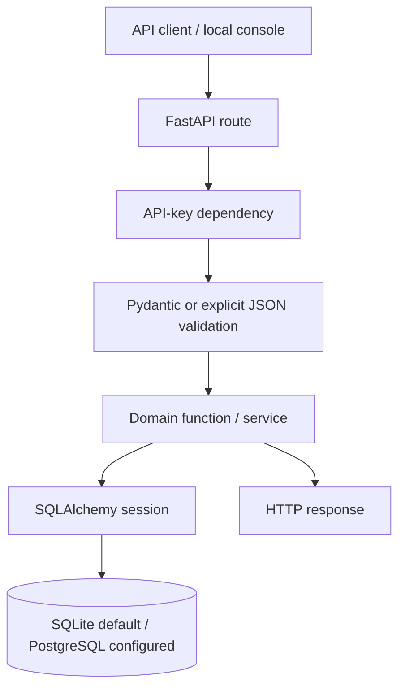
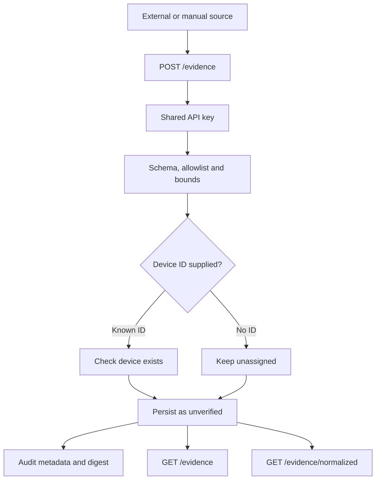

# Architecture

## 1. Design in one sentence

DeviceTrust is a Python modular monolith: FastAPI exposes the HTTP API, domain modules implement posture/SBOM/audit behavior, and SQLAlchemy persists the records.

It is deliberately a single application. The current scope does not justify the operational cost of microservices.

## 2. Request flow

For normal typed endpoints, Pydantic validates request models. The SBOM route reads the request stream directly so it can enforce a 2 MiB body limit before parsing JSON.

## 3. Main modules

| Module | Responsibility |
|---|---|
| `app/main.py` | FastAPI app, routes, authentication dependency, request orchestration and response serialization |
| `app/schemas.py` | Pydantic request contracts and field constraints |
| `app/db.py` | SQLAlchemy models, engine/session setup and database access |
| `app/posture.py` | Rules that assess the declared device security profile |
| `app/sbom.py` | CycloneDX subset parsing, PURL validation, local demo matching and optional OSV lookup |
| `app/evidence_normalization.py` | Pure normalizers for selected evidence attributes |
| `app/audit.py` | Transaction-serialized SHA-256 audit appends and chain verification |
| `web/` | Static same-origin operator console |

Routes coordinate work; domain rules should remain in their relevant modules rather than growing inside route handlers.

## 4. Data flows

### Device posture

The posture service evaluates declared fields such as authentication, encryption, update mechanism, secure boot and internet exposure. Missing fields produce `unverified` findings. The input is declared metadata, not a measurement collected from the device.

### Evidence observations

The normalized endpoint is a read-only projection. It preserves the raw value and does not change verification status or posture.

### SBOM and vulnerability findings

The API caps the request body at 2 MiB. The parser accepts a bounded CycloneDX JSON subset, validates component names/versions and PURLs, then checks the local synthetic advisory set. If `DEVICETRUST_OSV=1`, it also makes best-effort OSV queries. A failed or empty lookup is not proof that a component is safe.

### Triage and audit

A triage update requires a justification. State-changing operations append audit entries in the same database transaction as the domain mutation. Authenticated write requests acquire the singleton audit-chain state row before database reads; PostgreSQL serializes through the row update lock, while SQLite starts an IMMEDIATE write transaction. Both backends use a 10-second lock wait bound. The lock is held until commit or rollback, so concurrent application writers sharing the same database cannot append from the same chain head. Each entry hashes its content and the previous entry hash. The chain has no external checkpoint and is not immutable storage.

## 5. Trust boundaries

- API clients are untrusted; protected routes use one shared API key.
- The key represents a broad local operator boundary, not a human identity or role.
- Uploaded SBOM and evidence values are untrusted input.
- Evidence references are opaque; the application does not fetch them.
- Device security attributes are declarations and are not independently attested.
- OSV is an external dependency and is optional/best-effort.
- The database and audit chain share the same trust boundary; a privileged database attacker can rewrite both. Writer serialization does not provide independent tamper resistance.

## 6. Persistence and deployment

SQLite is the default local database. PostgreSQL can be selected with `DATABASE_URL`. Alembic owns schema evolution: apply migrations explicitly with `alembic upgrade head`; application startup does not create or alter tables. The container startup script applies pending migrations before launching the API, and the demo seeder upgrades its target database before inserting synthetic records.

The initial migration establishes the existing schema; it does not automatically convert an arbitrary legacy SQLite database. Follow the backup, schema-verification and explicit `alembic stamp` procedure in the [Demo runbook](demo-runbook.md) only when the existing schema has been verified to match the baseline.

CI covers SQLite migration upgrade/downgrade, ORM metadata drift and PostgreSQL persistence after engine disposal/reconnection. A clean local Compose deployment, backup/restore and deployment rollback have not yet been demonstrated.

The static console is served from the same FastAPI origin. It avoids a separate frontend build/deployment pipeline, but it is not a production authentication architecture.

## 7. Implemented versus future work

| Capability | Current state |
|---|---|
| Inventory and declared-profile posture | Implemented prototype |
| Evidence ingestion and listing | Implemented prototype |
| Selected-attribute normalization projection | Implemented prototype |
| Automatic device association/conflict resolution | Not implemented |
| Evidence-driven posture | Not implemented |
| Bounded CycloneDX ingestion | Implemented prototype |
| Synthetic local advisory matching | Implemented demo behavior |
| Optional OSV lookup | Best-effort integration |
| Justified vulnerability triage | Implemented prototype |
| JSON/Markdown reports | Implemented prototype |
| Hash-chain verification | Implemented with limitations |
| Individual identity/RBAC/tenant isolation | Not implemented |
| External audit anchoring and immutable retention | Not implemented; transactional writer serialization is not an external checkpoint |

## 8. Where to verify behavior

- Routes and orchestration: `app/main.py`
- Request constraints: `app/schemas.py`
- Persistence: `app/db.py`
- Posture rules: `app/posture.py`
- SBOM parsing and matching: `app/sbom.py`
- Evidence normalization: `app/evidence_normalization.py`
- Audit hashing: `app/audit.py`
- Tests: `tests/`

Related documents: [Engineering decisions](engineering-decisions.md), [Threat model](threat-model.md), [Security controls](security-controls.md).
