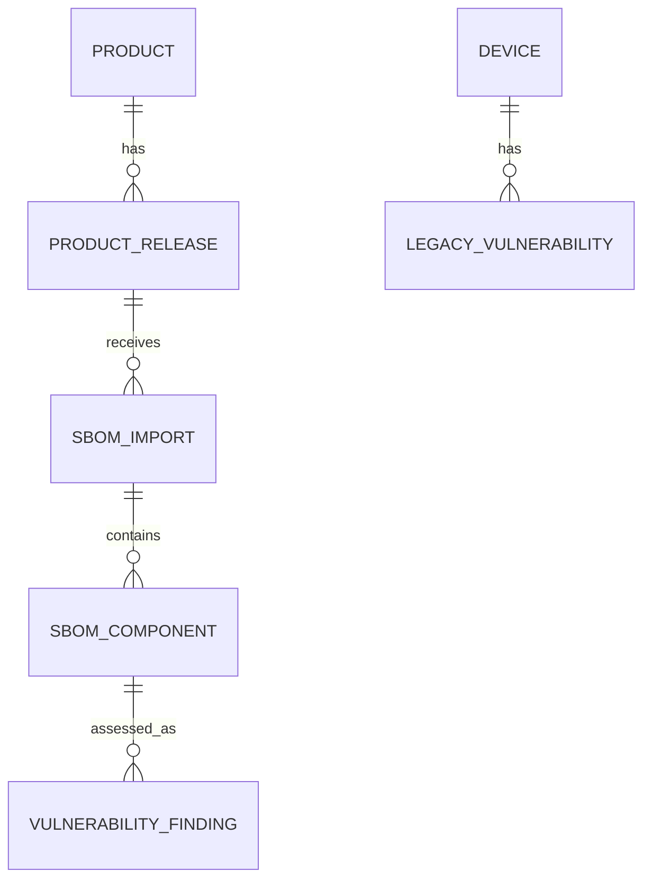

# Persistent Product and SBOM Domain Design

**Status:** Revised proposal — v1 decisions clarified; requires review before schema implementation  
**Scope:** Milestone 3 (P1), linked to issue #18

## 1. Design objective

Create a traceable history from a product release to the exact SBOM import, component record and vulnerability finding that produced an assessment. A later SBOM import must not overwrite the earlier evidence.

This design is a proposal, not an implemented capability or a claim of CRA conformity.

## 2. Domain boundaries

Keep these concepts distinct:

- **Device:** an installed or managed physical/logical asset already represented by the current `devices` table.
- **Product:** a manufacturer-defined product family or product identity.
- **Product release:** a specific product version and, where relevant, hardware revision.
- **SBOM import:** one accepted ingestion event for a product release, with immutable provenance and parser outcome.
- **SBOM component:** a component occurrence in one specific SBOM import. It is a snapshot, not a globally deduplicated component identity.
- **Vulnerability finding:** an assessment result tied to the exact component occurrence that produced it; the import is derived through that component.

A device is not automatically a product or a product release. Do not infer this relationship from device ID, hostname, MAC address, model name or vendor text. A future explicit deployment/asset-to-product-release association may be added only with a reviewed source and provenance.

## 3. Proposed relational model

### Product

Proposed fields:

- `id`: generated primary key.
- `manufacturer`: declared manufacturer name; not an independently verified identity.
- `product_name`: declared product name.
- `external_reference`: optional manufacturer-controlled identifier, stored as opaque text.
- `created_at`: UTC timestamp.

Do not make manufacturer/name a globally unique identity. Names can collide and change.

### ProductRelease

Proposed fields:

- `id`, `product_id` (foreign key).
- `version`: declared release/version string, preserved as supplied after bounded validation.
- `hardware_revision`: optional declared revision.
- `release_reference`: optional opaque manufacturer reference.
- `created_at`.

Use the generated `id` as the authoritative ProductRelease identity. Do not add a uniqueness constraint over declared manufacturer, product, version, hardware revision or release-reference fields in v1: these values may be missing, duplicated or changed, and no trustworthy cross-vendor natural key is established. Preserve version text; ecosystem-specific comparison belongs in later assessment logic.

### SBOMImport

Proposed fields:

- `id`, `product_release_id` (foreign key).
- `format` and `spec_version`.
- `source_type`: controlled value such as manual upload or pipeline import.
- `source_reference`: optional opaque reference; never fetched automatically.
- `content_sha256`: digest of the exact uploaded bytes.
- `imported_at`: server-recorded UTC timestamp.
- `parser_version`.
- `status`: `accepted` for every persisted import in v1.
- `component_count` and a bounded validation summary.

Enforce idempotency in the database with a unique constraint on `(product_release_id, format, content_sha256)`. The service must still handle concurrent insert races by rolling back and loading the already-committed matching import; application-only pre-checks are insufficient.

Do not store raw SBOM documents in the first iteration unless a retention, access-control and size policy is approved. A digest plus parsed snapshot gives traceability without silently introducing a document vault. If raw retention is later required, treat it as a separate security/storage decision.

### SBOMComponent

One row represents one component occurrence within one import:

- `id`, `sbom_import_id` (foreign key).
- `ordinal`: source position, stable within the import.
- `name`: source name preserved after bounded validation (do not lowercase or otherwise rewrite the stored source value).
- `version`: source version preserved after bounded validation.
- `purl`: original validated PURL string, nullable.
- Parsed PURL fields (type, namespace, name, version) may be stored only when parsing succeeds.
- v1 does not persist `supplier`, `scope` or `bom_ref`; these fields are not currently returned by the parser. Add them only in a separately scoped parser-contract change with fixtures and validation.

Use a uniqueness constraint on `(sbom_import_id, ordinal)`. Do not globally unique components by name/version or PURL: the same component may occur in different releases/imports, and PURLs can be missing or ambiguous.

### Vulnerability finding

New product-release findings must reference `sbom_component_id`. The import is derivable through the component's `sbom_import_id`; do not duplicate the import foreign key on the finding in v1. This makes the component occurrence the single authoritative provenance path and avoids inconsistent component/import pairs.

The existing `vulnerabilities` table is device-scoped and has a unique key on device/component/version/vulnerability ID. Do not repurpose it as a product finding table without a reviewed migration. Prefer a separate product-scoped finding model in the first implementation, or explicitly document and test a nullable-FK extension if a shared table is selected.

Legacy device findings remain valid with no inferred product/release association.

## 4. Import and idempotency semantics

1. Read the request with the existing streaming body-size cap.
2. Validate document shape, supported format/version and component bounds.
3. Compute SHA-256 over the exact request bytes, not a re-serialized JSON object. The request-reading boundary must return both the bounded raw bytes (or their digest) and the decoded document; compute the digest before JSON decoding/normalization and pass it explicitly to the persistence service.
4. Bind the import to an explicitly selected product release.
5. For an identical digest on the same release and format, return the existing accepted import (idempotent retry) rather than duplicating component rows.
6. A changed digest creates a new import record; prior imports and component snapshots remain unchanged.
7. V1 does not support partial imports. Persist an `SBOMImport` only after the entire document passes validation and the accepted snapshot is committed successfully. Invalid documents return bounded validation errors and create no import row. A separate ingestion-attempt model is deferred; do not represent rejected requests as accepted imports.
8. Compare two accepted imports by component occurrence and canonical identifiers only where unambiguous. Report additions, removals, version changes and unresolved comparisons separately.

The digest is a content-integrity identifier, not proof of source authenticity or manufacturer authorship.

## 5. Identity and matching rules

- Valid PURL is the preferred package identifier for supported ecosystems.
- Preserve the original PURL and validate it; never silently rewrite an invalid PURL into a valid identity.
- Missing PURL does not mean the component is invalid. Retain bounded source name/version fields but mark matching as limited.
- Never match across ecosystems using package name alone.
- Do not infer supplier from PURL namespace unless the data contract explicitly defines that interpretation.
- Preserve duplicate occurrences and source order; duplicate components may be meaningful in an SBOM.
- Do not claim that a PURL proves a component is actually present in a device.

## 6. Migration and compatibility strategy

- Add all new tables through a new Alembic revision; do not modify the already-applied baseline migration.
- Keep the existing `devices` and device-scoped SBOM endpoint behavior during the first migration.
- Do not backfill legacy device SBOM findings into product releases: current records do not contain reliable product/release provenance.
- Keep existing API response contracts stable until the new product-scoped endpoints are introduced.
- Add foreign keys, indexes and uniqueness constraints with SQLite and PostgreSQL behavior tested.
- Test migration upgrade and downgrade on disposable databases. A downgrade must not be presented as data-safe if it drops product/import history.

## 7. Security and privacy

- SBOM content is untrusted input. Preserve request and parser limits.
- Bound every persisted string and collection; avoid unbounded JSON payloads.
- Use parameterized ORM operations and explicit authorization dependencies on new endpoints.
- Do not expose raw source references or uploaded content by default.
- Keep secrets and credentials out of SBOM metadata, logs and audit payloads.
- Record who initiated an import only when a trustworthy actor identity exists. The current shared API key maps to a broad local actor, not an individual.
- Keep tenant isolation and multi-user claims out of scope until identity foundations exist.

## 8. Required tests

- Valid, malformed, oversized and unsupported SBOM documents.
- Missing, invalid and version-mismatched PURLs.
- Ecosystem collisions and same-name packages from different package types.
- Duplicate component occurrences within one import.
- Parser preserves source component name/version values within bounds; storage does not lowercase or silently rewrite source fields.
- v1 does not claim to retain supplier, scope or bom-ref.
- Database uniqueness enforces one accepted import per `(product_release_id, format, content_sha256)`, including concurrent retries.
- Same digest imported for a different release.
- Changed digest creates a new immutable import and preserves old components.
- Component diff with added, removed, version-changed and unresolved identities.
- Foreign-key integrity and transaction rollback when a component/finding write fails; no partially accepted import is committed.
- SQLite migration upgrade/downgrade and PostgreSQL integration.
- Existing device-scoped import, finding, triage and report tests remain valid.

## 9. Proposed decisions for design review

The current implementation does not provide trustworthy manufacturer identifiers or individual actor identity. The following defaults minimise false identity claims and preserve compatibility:

1. **Product identity:** use an internal generated ID as the authoritative database identity. Treat manufacturer, product name and optional external reference as declared attributes, not a natural key. Do not enforce global uniqueness on names. When no trustworthy manufacturer identifier exists, keep potentially duplicate product records separate and expose duplicate detection as a review task; never auto-merge them. Product-release identity follows the same rule: preserve the declared version and optional hardware/release references, without assuming SemVer or inventing a cross-vendor uniqueness key.
2. **Rejected and partial ingestion:** v1 persists only fully accepted imports. Invalid documents return bounded validation errors and create no `SBOMImport` row. Partial imports and a separate ingestion-attempt entity are out of scope; do not log raw SBOM content.
3. **Product findings:** introduce a separate product-scoped finding model referencing the exact `SBOMComponent` occurrence. Keep the existing device-scoped `vulnerabilities` table and its uniqueness semantics unchanged.
4. **Component source fields:** persist bounded source `name`, `version` and original validated `purl` in v1. Preserve source name casing; parser/storage must not lowercase source data. Do not persist `supplier`, `scope` or `bom_ref` in v1 because the current parser does not expose them. Any later expansion requires its own parser contract and regression fixtures.
5. **Finding provenance:** `sbom_component_id` is the sole authoritative provenance foreign key; derive the import through the component. Do not add a redundant `sbom_import_id` to findings unless a later design includes a database-enforced composite consistency constraint.
6. **Digest:** compute SHA-256 over the exact bounded request bytes before JSON decoding or normalization. The request boundary must pass the digest to the persistence service; hashing a re-serialized Python dictionary is not equivalent.
7. **CycloneDX contract:** initially support JSON only and `specVersion` `1.5`, as implemented in PR #20. This is a deliberately narrow application contract, not full CycloneDX schema validation; do not claim full specification support.

These v1 defaults are now explicit proposals for review. The implementation PR must encode them in constraints, service-level invariants and tests.

## 10. Explicit non-goals

- No automatic mapping from devices to products or releases.
- No global component identity registry.
- No KEV/EPSS enrichment, VEX export or CRA legal conclusions.
- No SPDX ingestion.
- No raw SBOM document vault.
- No SaaS, tenant isolation or multi-user authorization.
- No claims of complete SBOM validation or vulnerability coverage.

## References

- [Issue #18 — Persistent product releases, SBOM imports and component inventory](https://github.com/silvatechf/DeviceTrust/issues/18)
- [Current architecture](architecture.md)
- [Roadmap](roadmap.md)
- [Security controls](security-controls.md)
- [Release readiness](release-readiness.md)
